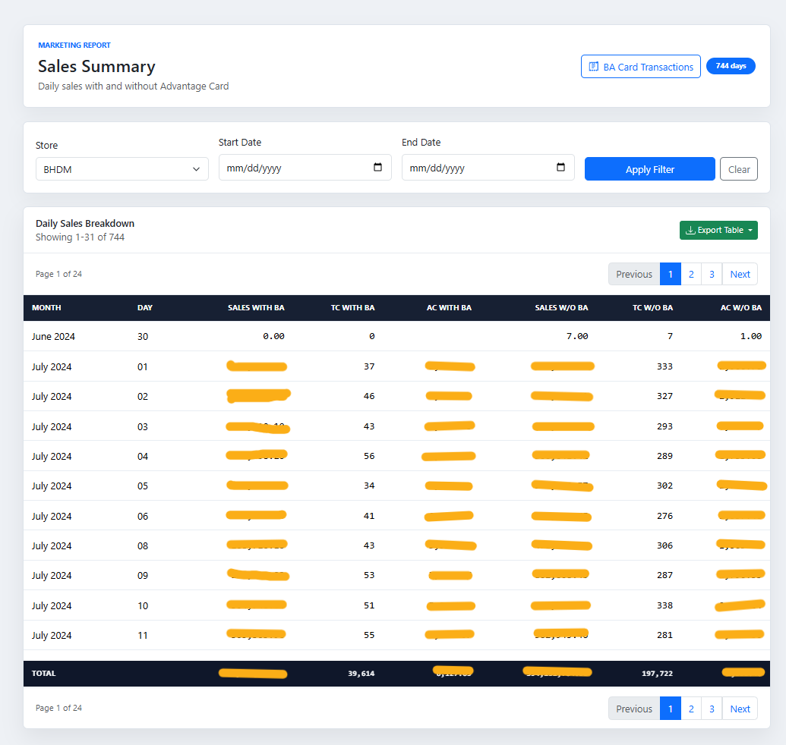
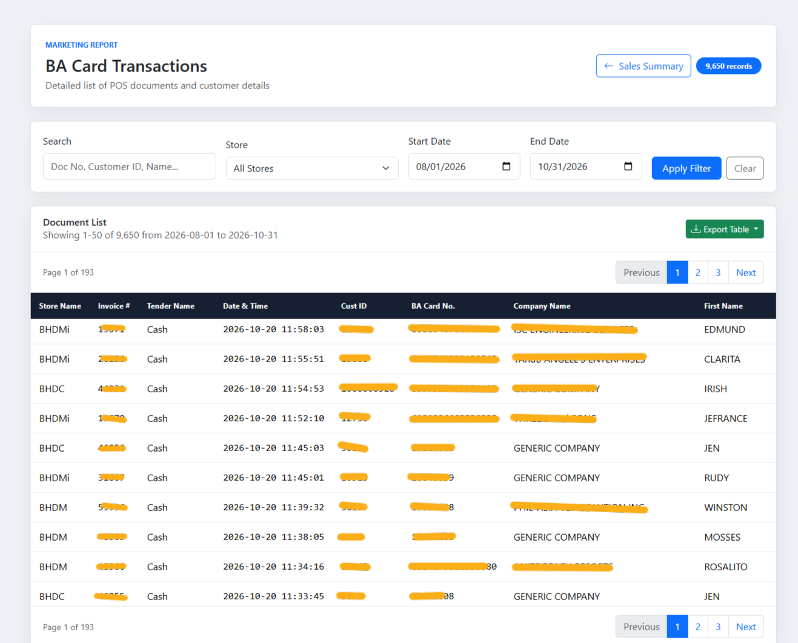

# Marketing Sales Summary

A PHP reporting application for viewing daily sales summaries and Advantage Card document transactions. Users can filter results by store, date, or document search criteria, paginate through records, and export filtered data as CSV or Excel-compatible XLSX files.

## Screenshots

### Sales Summary



### BA Card Transactions



## Features

- Daily sales summary with and without Advantage Card metrics
- Document transaction search and filtering
- Store and date filters
- Pagination for both report tables
- CSV and XLSX exports
- Responsive layout using Bootstrap 5

## Requirements

- PHP with the OCI8 extension enabled
- Access to an Oracle database containing the report data
- A web server or PHP's built-in development server
- An internet connection to load Bootstrap from jsDelivr

The project does not currently use Composer or npm dependencies. XLSX output is generated by the included `database/xlsx_writer.php` implementation.

## Configuration

For local development, copy `.env.example` to `.env` and fill in your Oracle connection settings. The application loads `.env` when present. Environment variables already provided by the server take precedence.

| Variable | Description |
| --- | --- |
| `ORACLE_USERNAME` | Oracle database username |
| `ORACLE_PASSWORD` | Oracle database password |
| `ORACLE_TNS` | Oracle TNS descriptor or connection string |
| `ORACLE_CHARSET` | Oracle character set; defaults to `AL32UTF8` |

Do not commit real credentials, TNS descriptors, or production data.

### Start the local server

```powershell
php -S 127.0.0.1:8000
```

The `.htaccess` file blocks direct access to `.env` on Apache. Configure equivalent protection if you use another web server.

For deployment, set the same values in your hosting environment instead of uploading a local `.env` file.

### Bash example for setting variables directly

```bash
export ORACLE_USERNAME="your_username"
export ORACLE_PASSWORD="your_password"
export ORACLE_TNS="your_tns_descriptor"
export ORACLE_CHARSET="AL32UTF8"
php -S 127.0.0.1:8000
```

Open <http://127.0.0.1:8000> for the sales summary or <http://127.0.0.1:8000/documents.php> for document transactions.

The PHP process must have network access to the Oracle database. If the database is on a private network, connect through the approved network or VPN before starting the application.

## Project layout

```text
api/                    JSON and export endpoints
app/helpers/            Shared PHP helpers
app/views/              Report pages and reusable view components
config/                 Environment-based configuration
database/               Oracle queries and XLSX writer
public/css/              Application styles
public/images/           Static images and favicon
public/js/               Browser-side report interactions
```

## Security note

Database credentials and connection details belong in environment variables, never in committed source files. If credentials from an earlier version of this project were exposed outside your local machine, rotate them with the database administrator.
